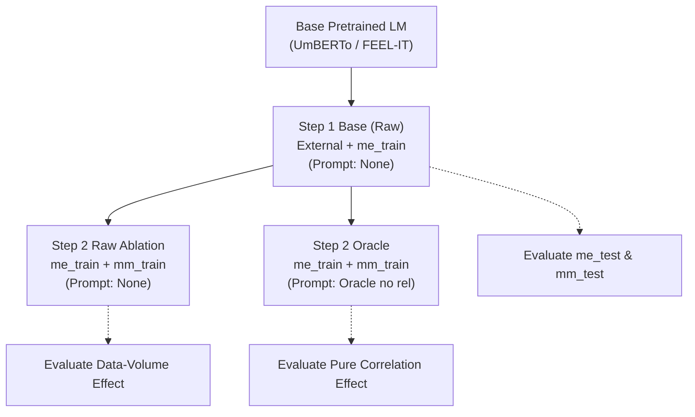
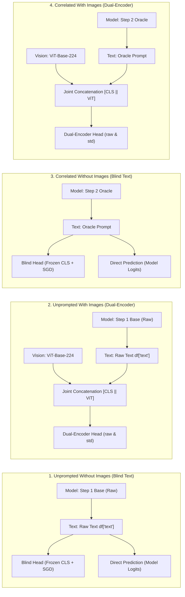

# MultiEMiT: Comprehensive Experimental Specification, Architecture & Benchmark Aims

> **Scope**: Official experimental protocol and ground truth for `code/bert/clean_paper_codes/` and `code/bert/final_codes_py/`.  
> **Target Venue**: *IEEE Transactions on Affective Computing*.  
> **Partition Protocol**: Deterministic splits locked to `SEED = 42`. Zero train-test leakage.  
> **Status**: **Source of Truth Reference Specification**.

---

## 1. Executive Summary & Narrative Spine

In Italian Social TV discourse, affective and figurative communication presents three structural challenges:
1. **Extreme Class Imbalance**: Social discourse is overwhelmingly literal and sincere ($78.5\%$ unironic in `me_test`, $80.6\%$ in `mm_test`), while critical affective states (*Sarcasmo*, *Paura*, *Rabbia*) inhabit the extreme long tail (e.g., only 7 *Sarcasmo* instances in `mm_test`).
2. **Pragmatic Ambiguity in Unimodal Text**: Brief, colloquial tweets lack the context needed to resolve emotional ambiguity (e.g., distinguishing satirical *Gioia* from reactive *Disgusto*).
3. **The Multimodal Incongruity Gap**: Accompanying imagery (reaction memes, broadcast screenshots) does not merely illustrate text; in figurative discourse, images frequently contradict or elaborate upon textual sentiment, creating semantic divergence.

To address these challenges, the MultiEMiT benchmark evaluates three core mechanisms:
* **Oracle Correlation Prompting**: Prepending structured natural language verbalizations of auxiliary, non-target pragmatics (*Broadcast Target*, *Offensiveness*, *Figurativeness*, *Emotions*) to guide classification.
* **Controlled Two-Stage Ablation**: Implementing a **Step 2 Raw Ablation** to mathematically separate the benefit of adding in-domain training data from the true effect of correlation priors.
* **Dual-Encoder Late Fusion (BERT + ViT-224)**: Concatenating frozen 768-d text `[CLS]` embeddings with frozen 768-d Vision Transformer representations under controlled feature scaling (`std` vs. `raw`).

---

## 2. Corpora & Partitioning Protocol

All dataset splits use `SEED = 42` to guarantee strict comparability across models:

| Partition / Corpus | Source File | Instances ($N$) | Modalities | Role in Benchmark |
| :--- | :--- | :---: | :---: | :--- |
| **MultiEMiT Textual Train (`me_train`)** | `textual_only_cleaned.csv` | **1,618** | Text | 80% split of textual corpus. Used for Step 1 & Step 2 encoder training. |
| **MultiEMiT Textual Test (`me_test`)** | `textual_only_cleaned.csv` | **405** | Text | 20% held-out test split. Unimodal benchmark for Emotion & Irony. No image, so **no relation clause**. |
| **MultiEMiT Multimodal Train (`mm_train`)** | `multimodal_train_seed42.csv` | **516** | Text + Image | 80% split of multimodal corpus. Training set for linear heads and Task 3 models. |
| **MultiEMiT Multimodal Test (`mm_test`)** | `multimodal_test_seed42.csv` | **129** | Text + Image | 20% held-out test split for all multimodal evaluations and Task 3. |
| **EMit A (External)** | `cleaned_emit_train_A.csv` | **5,966** | Text | EVALITA 2023 emotion corpus. Split 80/20 (**4,772 train** / 1,194 val) for Task 1 Step 1. |
| **IronITA (External)** | `ironita_full.xlsx` | **4,849** | Text | EVALITA 2018 irony benchmark. Split 80/20 (**3,879 train** / 970 val) for Task 2 Step 1. |

### Multimodal Test Set Subsets (`mm_test`, $N=129$)
* **Additive (`ADD`)**: Text and image complement each other ($N=68$, 52.7%).
* **Parallel (`PAR`)**: Text and image convey redundant literal information ($N=23$, 17.8%). Strictly sincere ($100\%$ unironic).
* **Divergent (`DIV`)**: Text and image contrast or conflict ($N=38$, 29.5%). Primary locus of irony ($47.4\%$ figurative).

---

## 3. Textual Encoders & Two-Stage Training Pipeline

### 3.1 Model Architectures
* **Task 1 (Emotion Detection)**: FEEL-IT (`rinformatica/modello-sentiment-italian-feel-it-camemberta`), 10 Plutchik emotion labels, multi-label classification.
* **Task 2 (Irony & Sarcasm)**: UmBERTo (`Musixmatch/umberto-commoncrawl-cased-v1`), 3-class single-label (`None=0`, `Ironia=1`, `Sarcasmo=2`).
* **Task 3 (Semiotic Relation)**: UmBERTo (`Musixmatch/umberto-commoncrawl-cased-v1`), 3-class single-label (`Additiva=0`, `Divergente=1`, `Parallela=2`).

### 3.2 Training Recipe & Stages
All fine-tuning stages use: 10 epochs, learning rate $2\times 10^{-5}$, batch size 16, weight decay 0.01, best checkpoint selected by validation Macro F1.
Deterministic shuffling: Dataframes are shuffled via `.sample(frac=1.0, random_state=seed).reset_index(drop=True)` and `seed_everything(seed)` is called before each stage.



1. **Step 1 Base (Raw)**:
   - Initialized from base pretrained LM.
   - Trained on external benchmark (`EMit A` or `IronITA`) + `me_train` (raw text).
   - Evaluated on `me_test` (raw text).
2. **Step 2 Raw (Ablation)**:
   - Initialized from **Step 1 Base**.
   - Continued training on `me_train` + `mm_train` ($N=2,134$) with **raw text** (no correlations).
   - Isolates the effect of adding 516 in-domain posts without correlation prompting.
3. **Step 2 Oracle (With Correlations)**:
   - Initialized from **Step 1 Base**.
   - Continued training on `me_train` + `mm_train` ($N=2,134$) with **Oracle correlations (`no rel`)**.
   - Direct comparison between Step 2 Oracle and Step 2 Raw proves the pure correlation gain.

---

## 4. Correlation Prompting Mechanics

### 4.1 Structured Template Format
All correlation prompts prepend structured verbalizations of the gold auxiliary annotations:
$$\text{"il seguente testo "} \Vert [\text{esprime } \langle\text{emozioni}\rangle] \Vert [\text{ha una relazione } \langle\text{relazione}\rangle] \Vert [\text{contiene } \langle\text{ironia/sarcasmo/offensivita}\rangle] \Vert [\text{riguarda } \langle\text{target}\rangle] \Vert \langle\text{testo}\rangle$$

*(The task's own target layer is **strictly excluded** from its prompt).*

### 4.2 Injected Layers per Task
| Task | Target (Excluded) | Injected Auxiliary Layers | Prompt Variants |
| :--- | :--- | :--- | :--- |
| **Task 1: Emotion** | `Emotions` | `Target` + `Ironia/Sarcasmo` + `Offensivita` | `Oracle (no rel)` and `Oracle (+ rel)` |
| **Task 2: Irony** | `Ironia/Sarcasmo` | `Emotions` + `Target` + `Offensivita` | `Oracle (no rel)` and `Oracle (+ rel)` |
| **Task 3: Relation** | `Relation` | `Emotions` + `Target` + `Ironia/Sarcasmo` + `Offensivita` | `Oracle` (relation is the target) |

### 4.3 Why Semiotic Relation (`rel`) Was Excluded in Text vs. Evaluated in Multimodal
1. **Why `rel` Is Absent in Textual Encoders (`me_train`, `me_test`)**:
   - Purely textual tweets ($2,023$ instances in `textual_only_cleaned.csv`) have **no attached images**, so they cannot possess a semiotic relation.
   - In Step 2 training (`me_train + mm_train` = 2,134 rows), 76% of rows have no image and thus no relation.
   - Therefore, Step 2 textual encoders are fine-tuned **without relation tokens (`Oracle (no rel)`)**.
   - Evaluating `me_test` is strictly performed with `Oracle (no rel)`.
2. **Behavior on Multimodal Test Set (`mm_test`, $N=129$)**:
   - In **Task 1 (Emotion Detection)**: Appending `+ rel` provides positive regularizing evidence (*Fiducia* / *Gioia* align with `ADD` / `PAR`), boosting Dual-Encoder Macro F1 to **$0.497$** and Micro F1 to **$0.553$**.
   - In **Task 2 (Irony Detection)**: `Oracle (no rel)` achieves the benchmark peak (**80.62% Accuracy**, **0.5424 Macro F1**). Appending `+ rel` creates an out-of-distribution shift and introduces noise because more than half ($52.6\%$) of Divergent posts are sincere (`None`). Conditioning on affective cues (*Disgusto*, *Gioia*, *Offensivita*) is far more discriminative than high-level semiotic category tags.

---

## 5. The Multimodal Late-Fusion Architecture

Due to the compact size of `mm_train` ($N=516$), encoders are **frozen** during multimodal fusion:
* **Text Embedding ($\mathbf{h}_{\text{txt}}$)**: Frozen 768-d last-layer `[CLS]` token extracted from the fine-tuned Transformer.
* **Image Embedding ($\mathbf{h}_{\text{img}}$)**: Frozen 768-d `[CLS]` token extracted from `google/vit-base-patch16-224`.
* **Joint Representation**:
  $$\mathbf{h}_{\text{joint}} = [\mathbf{h}_{\text{txt}} \;\Vert\; \mathbf{h}_{\text{img}}] \in \mathbb{R}^{1536}$$
* **Linear Classification Head**:
  - `SGDClassifier(loss="squared_hinge", penalty="l2", class_weight="balanced", random_state=42)`.
  - For multi-label Emotion, wrapped in `ClassifierChain`.
  - Trained on `mm_train` ($N=516$), evaluated on `mm_test` ($N=129$).

---

## 6. The 4 Core Multimodal Experiments (per Task)

For every task, the multimodal evaluation follows the identical 4-experiment grid:



### Breakdown of the 4 Experiments:
1. **Experiment 1 (Unprompted Unimodal / Blind Text)**:
   - Checkpoint: **Step 1 Base** (trained without correlations).
   - Text input: Raw text `df["text"]` (no correlations, no images).
   - Outputs:
     - Direct transformer prediction (fine-tuned model logits argmax/threshold).
     - Linear head on frozen `[CLS]` embeddings (`Blind Text`, evaluated on `raw` and `std`).
2. **Experiment 2 (Unprompted Multimodal / Dual-Encoder)**:
   - Checkpoint: **Step 1 Base** (trained without correlations).
   - Text input: Raw text `df["text"]` + ViT image embeddings.
   - Outputs:
     - Linear head on `[h_txt || h_img]` (`Dual-Encoder`, evaluated on both `raw` and `std`).
     - Semiotic subset breakdown (ADD / PAR / DIV).
3. **Experiment 3 (Correlated Unimodal / Blind Text)**:
   - Checkpoint: **Step 2 Oracle** (trained with correlations).
   - Text input: Oracle prompt (with correlations, without images).
   - Outputs:
     - Direct transformer prediction on oracle text.
     - Linear head on frozen `[CLS]` embeddings (`Blind Text`, evaluated on `raw` and `std`).
4. **Experiment 4 (Correlated Multimodal / Dual-Encoder)**:
   - Checkpoint: **Step 2 Oracle** (trained with correlations).
   - Text input: Oracle prompt + ViT image embeddings.
   - Outputs:
     - Linear head on `[h_txt || h_img]` (`Dual-Encoder`, evaluated on both `raw` and `std`).
     - Semiotic subset breakdown (ADD / PAR / DIV).

---

## 7. Feature Scaling Protocol: `std` vs. `raw`

Because text and vision encoders possess different latent norms and feature variances, feature standardization behaves differently across tasks:

1. **Why `std` Is Essential for Task 2 (Irony)**:
   - In `raw` unscaled mode, fitting `SGDClassifier(class_weight="balanced")` under extreme class imbalance (only 7 *Sarcasmo* examples in `mm_test`) causes severe gradient step instability.
   - Without scaling, the Step 1 Blind Text head collapses to **$35.66\%$** accuracy.
   - Applying `StandardScaler` (fitted on `mm_train` text and image features separately) completely stabilizes the optimization:
     - Step 1 Blind Text jumps from $35.66\% \to \mathbf{75.97\%}$.
     - Step 2 Oracle Dual-Encoder achieves the **benchmark peak: 80.62% Accuracy ($0.5424$ Macro F1)**.
2. **Why `raw` Performs Best for Task 1 (Emotion) and Task 3 (Relation)**:
   - For **Multi-label Emotion (Task 1)**, the `ClassifierChain` smooth loss naturally regularizes margin distances across binary emotion hyperplanes; `raw` features achieve $0.497$ Macro F1 (vs. $0.454$ in `std`).
   - For **Semiotic Relation (Task 3)**, `raw` features yield the peak Macro F1 of **$0.6242$** (vs. $0.6116$ in `std`), achieving the highest recall ($56.5\%$) on the minority *Parallela* class.

---

## 8. Ablations Matrix

| Ablation | Design & Aim | Key Finding |
| :--- | :--- | :--- |
| **A1: Data Volume Ablation (`Step 2 Raw`)** | Fine-tune Step 1 on `me_train + mm_train` with **raw text** (no correlations). Isolates data volume from correlation prior. | Continued unprompted training leaves `Ironia` F1 frozen ($0.3375 \to 0.3378$). 100% of the Step 2 gain is driven by correlations. |
| **A2: Semiotic Relation Clause (`+ rel`)** | Appends `ha una relazione [ADD/PAR/DIV]` to the multimodal test prompt. | Helps Emotion ($0.407 \to 0.497$ Macro F1); degrades Irony ($0.542 \to 0.448$ Macro F1) due to sincere Divergent noise. |
| **A3: Feature Standardization (`std` vs `raw`)** | Standardizes text and image embeddings separately using `StandardScaler` fitted on `mm_train`. | Essential for Irony (prevents linear head collapse on 7 Sarcasmo posts); neutral/suboptimal for Emotion and Relation. |

---

## 9. Official Publication Tables Mapping

| Paper Table | Task & Focus | Partition ($N$) | Primary Reported Rows | Output Files |
| :--- | :--- | :---: | :--- | :--- |
| **Table I** | Emotion Baselines | `me_test` (405) & `mm_test` (129) | Textual Base, Textual Corr, Blind Text (No corr), Dual-Encoder (No corr), Blind Text (With corr, +rel), Dual-Encoder (With corr, +rel) | `multimodal_emotion_baselines.csv`, `paper_baselines_summary.csv` |
| **Table III** | Emotion Semiotic Subsets | `mm_test` (129) | Dual-Encoder (Step 1 Base, raw) vs Dual-Encoder (Step 2 Oracle, raw) across ADD (68), PAR (23), DIV (38) | `multimodal_emotion_subsets.csv`, `paper_subsets_summary.csv` |
| **Table IV** | Irony Baselines | `me_test` (405) & `mm_test` (129) | Textual Base, Textual Corr, Blind Text (No corr, std), Dual-Encoder (No corr, std), Blind Text (With corr, std), Dual-Encoder (With corr, std), Ablation (+rel, raw) | `multimodal_irony_baselines.csv`, `paper_baselines_summary.csv` |
| **Table VI** | Irony Semiotic Subsets | `mm_test` (129) | Dual-Encoder (Step 1 Base, std) vs Dual-Encoder (Step 2 Oracle, std) across ADD (68), PAR (23), DIV (38) | `multimodal_irony_subsets.csv`, `paper_subsets_summary.csv` |
| **Table VII** | Relation Baselines | `mm_test` (129) | Stage A Raw (Blind & Dual), Stage B Oracle (Blind & Dual) on `raw` features | `multimodal_relation_baselines.csv`, `paper_baselines_summary.csv` |
| **Table IX** | Relation Class Breakdown | `mm_test` (129) | Dual-Encoder Stage A Raw vs Stage B Oracle across Additiva (68), Parallela (23), Divergente (38) | `multimodal_relation_target_classes.csv` |
| **Table II** | Unconfounded Ablation Matrix | `me_test` (405) | Step 1 Base vs Step 2 Raw vs Step 2 Oracle ($\Delta$ Pure Correlation Gain) | `paper_ablation_matrix.csv` |

---

## 10. Execution Command Reference

To run the complete suite from scratch:

```powershell
# Master pipeline: trains missing models, evaluates all multimodal heads, and compiles paper tables
python code/bert/clean_paper_codes/run_paper_experiments.py --task all --results-dir results_final --checkpoints-dir checkpoints_final

# Or run individual task multimodal evaluations:
python code/bert/clean_paper_codes/evaluate_multimodal_emotion.py --checkpoints-dir checkpoints_final --results-dir results_final
python code/bert/clean_paper_codes/evaluate_multimodal_irony.py --checkpoints-dir checkpoints_final --results-dir results_final
python code/bert/clean_paper_codes/evaluate_multimodal_relation.py --checkpoints-dir checkpoints_final --results-dir results_final
```
