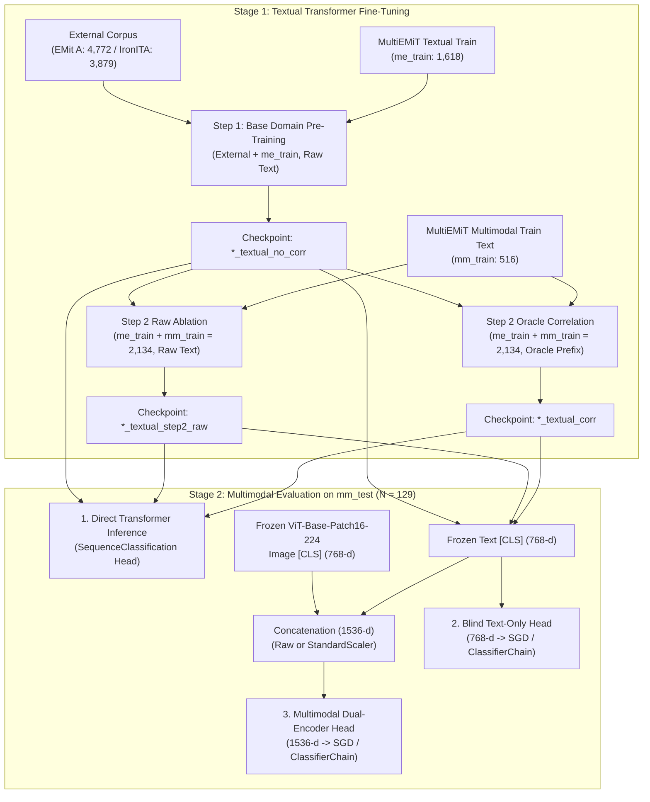

# MultiEMiT Experimental Framework: Task-by-Task Methodology, Pipelines, and Empirical Results

This document provides a complete, self-contained technical specification and empirical analysis of the discriminative unimodal (BERT-family) and multimodal (Dual-Encoder BERT + ViT) experiments on the **MultiEMiT** benchmark, implemented in [`code/bert/final_codes_py/`](file:///d:/vsc_projects/MultiEMit/MultiEMit/code/bert/final_codes_py).

The central scientific goal of these experiments is not merely chasing leaderboard numbers, but **quantifying what cross-dimensional pragmatic correlations and multimodal semiotic signals contribute** across three interconnected tasks in Italian social media discourse:
1. **Task 1 — Emotion Detection**: 10-class multi-label classification grounded in Plutchik's taxonomy.
2. **Task 2 — Irony & Sarcasm Detection**: 3-class single-label figurative language classification.
3. **Task 3 — Semiotic Relation Classification**: 3-class single-label classification of text–image interaction.

---

## 1. Datasets, Partitioning Protocol, and Label Distributions

### 1.1 Partitioning & Fixed-Seed Protocol

To ensure strict separation between unimodal textual evaluation and multimodal evaluation while maintaining full comparability with external models, all dataset splits are locked to `SEED = 42`:

| Partition / Corpus | File Path | Instances ($N$) | Modalities | Experimental Role |
| :--- | :--- | :---: | :---: | :--- |
| **MultiEMiT Textual-Only** | `correctly_split/textual_only_cleaned.csv` | **2,023** | Text | Split 80/20 (`SEED=42`, non-stratified): • **`me_train` = 1,618** (training) • **`me_test` = 405** (textual evaluation) |
| **MultiEMiT Multimodal Train** | `correctly_split/multimodal_train_seed42.csv` | **516** | Text + Image | Step 2 textual domain adaptation; training split for all multimodal heads and Task 3 models (80% of multimodal corpus). |
| **MultiEMiT Multimodal Test** | `correctly_split/multimodal_test_seed42.csv` | **129** | Text + Image | Hold-out test set for all multimodal evaluations and Task 3 (20% of multimodal corpus). |
| **EMit A (External)** | `emit/cleaned_emit_train_A.csv` | **5,966** | Text | Italian tweets annotated with the same 10 emotions. Split 80/20 (`SEED=42`): **4,772 train** / 1,194 val. Used in Task 1 Step 1. |
| **IronITA (External)** | `ironita/ironita_full.xlsx` | **4,849** | Text | EVALITA 2018 Italian irony/sarcasm benchmark. Split 80/20 (`SEED=42`, stratified): **3,879 train** / 970 val. Used in Task 2 Step 1. |

### 1.2 Label Taxonomies and Exact Distributions

#### Task 1: Emotion Detection (10-Class Multi-Label)
Each post is annotated with 10 independent binary emotion columns (`Amore`, `Anticipazione`, `Disgusto`, `Fiducia`, `Gioia`, `Neutro`, `Paura`, `Rabbia`, `Sorpresa`, `Tristezza`). A post may express multiple concurrent emotions (on average 1.35 labels/post in `me_train`, 1.34 in `me_test`, 1.27 in `mm_train`, and 1.19 in `mm_test`).

| Emotion Label | EMit A All ($N=5,966$) | `me_train` ($N=1,618$) | `me_test` ($N=405$) | `mm_train` ($N=516$) | `mm_test` ($N=129$) |
| :--- | :---: | :---: | :---: | :---: | :---: |
| **Amore** *(Love)* | 633 (10.6%) | 213 (13.2%) | 49 (12.1%) | 39 (7.6%) | 11 (8.5%) |
| **Anticipazione** *(Anticipation)* | 547 (9.2%) | 105 (6.5%) | 25 (6.2%) | 51 (9.9%) | 10 (7.8%) |
| **Disgusto** *(Disgust)* | 874 (14.6%) | 284 (17.6%) | 74 (18.3%) | 59 (11.4%) | 19 (14.7%) |
| **Fiducia** *(Trust)* | 1,665 (27.9%) | 364 (22.5%) | 83 (20.5%) | 172 (33.3%) | 42 (32.6%) |
| **Gioia** *(Joy)* | 650 (10.9%) | 343 (21.2%) | 90 (22.2%) | 139 (26.9%) | 29 (22.5%) |
| **Neutro** *(Neutral)* | 1,322 (22.2%) | 189 (11.7%) | 52 (12.8%) | 73 (14.1%) | 17 (13.2%) |
| **Paura** *(Fear)* | 91 (1.5%) | 41 (2.5%) | 12 (3.0%) | 3 (0.6%) | 1 (0.8%) |
| **Rabbia** *(Anger)* | 367 (6.2%) | 109 (6.7%) | 27 (6.7%) | 28 (5.4%) | 6 (4.7%) |
| **Sorpresa** *(Surprise)* | 591 (9.9%) | 344 (21.3%) | 89 (22.0%) | 66 (12.8%) | 16 (12.4%) |
| **Tristezza** *(Sadness)* | 545 (9.1%) | 186 (11.5%) | 42 (10.4%) | 23 (4.5%) | 2 (1.6%) |
| **Total Positive Annotations** | **7,285** | **2,178** | **543** | **653** | **153** |

#### Task 2: Irony & Sarcasm Detection (3-Class Single-Label)
Binary columns `Ironia` and `Sarcasmo` are mapped into three mutually exclusive classes via priority rule $\text{Sarcasmo (2)} > \text{Ironia (1)} > \text{None (0)}$:

| Class | IronITA All ($N=4,849$) | IronITA Train ($N=3,879$) | `me_train` ($N=1,618$) | `me_test` ($N=405$) | `mm_train` ($N=516$) | `mm_test` ($N=129$) |
| :--- | :---: | :---: | :---: | :---: | :---: | :---: |
| **0 — None** *(Unironic)* | 2,391 (49.3%) | 1,913 (49.3%) | 1,248 (77.1%) | 318 (78.5%) | 412 (79.8%) | 104 (80.6%) |
| **1 — Ironia** *(Irony)* | 1,329 (27.4%) | 1,063 (27.4%) | 344 (21.3%) | 79 (19.5%) | 91 (17.6%) | 18 (14.0%) |
| **2 — Sarcasmo** *(Sarcasm)* | 1,129 (23.3%) | 903 (23.3%) | 26 (1.6%) | 8 (2.0%) | 13 (2.5%) | 7 (5.4%) |

#### Task 3: Semiotic Relation Classification (3-Class Single-Label)
Defined exclusively on the multimodal corpus (`mm_train` and `mm_test`), categorizing the semantic relationship between the text and the attached image (`Parallela (2) > Divergente (1) > Additiva (0)`):

| Semiotic Relation Class | Code | Definition | `mm_train` ($N=516$) | `mm_test` ($N=129$) |
| :--- | :---: | :--- | :---: | :---: |
| **0 — Additiva** (`ADD`) | 0 | Text and image complement and elaborate on each other | 319 (61.8%) | 68 (52.7%) |
| **1 — Divergente** (`DIV`) | 1 | Text and image contrast or clash (e.g., ironic dissonance) | 120 (23.3%) | 38 (29.5%) |
| **2 — Parallela** (`PAR`) | 2 | Text and image convey redundant/independent literal content | 77 (14.9%) | 23 (17.8%) |

#### Contextual Annotation Layers (Used in Oracle Correlation Prompts)
Each MultiEMiT post also includes binary annotations for **Broadcast Target** (`Contenuto`: program content/guests/news; `Contenitore`: show host/studio/production) and **Offensiveness** (`Offensivita`):
- `me_train` ($1,618$): `Contenuto` = 803 (49.6%), `Contenitore` = 624 (38.6%), `Offensivita` = 36 (2.2%)
- `me_test` ($405$): `Contenuto` = 207 (51.1%), `Contenitore` = 158 (39.0%), `Offensivita` = 9 (2.2%)
- `mm_train` ($516$): `Contenuto` = 153 (29.7%), `Contenitore` = 316 (61.2%), `Offensivita` = 4 (0.8%)
- `mm_test` ($129$): `Contenuto` = 46 (35.7%), `Contenitore` = 79 (61.2%), `Offensivita` = 2 (1.6%)

---

## 2. Theoretical Inductive Bias: Oracle Correlation Prompting

Empirical analysis of the MultiEMiT annotations reveals strong statistical couplings across pragmatic dimensions:
- **Target $\leftrightarrow$ Emotion**: Program-loyalty emotions (*Fiducia*, *Anticipazione*) correlate with `Contenitore`, whereas reactive emotions (*Sorpresa*, *Tristezza*, *Disgusto*) correlate with `Contenuto`.
- **Figurative Speech $\leftrightarrow$ Negative Affect & Offensiveness**: *Sarcasmo* correlates strongly with *Disgusto*, *Rabbia*, and *Offensivita*.
- **Semiotic Divergence $\leftrightarrow$ Irony**: In the multimodal test set, **72.0% (18 out of 25)** of all ironic/sarcastic posts have a `Divergente` text–image relation, whereas **100% (23 out of 23)** of `Parallela` posts are non-ironic (`None`).

To quantify how much these cross-layer dependencies improve neural representations—and to establish an **oracle upper bound** that motivates future multi-task and joint-inference architectures—we prepend structured Italian natural-language prefixes built from the **gold annotations of the non-target layers** of each sample ([`common_utils.py`](file:///d:/vsc_projects/MultiEMit/MultiEMit/code/bert/final_codes_py/common_utils.py)):

$$\text{Prompted Text} = \text{``il seguente testo ''} \;\Vert\; [\text{esprime } \langle\text{emozioni}\rangle] \;\Vert\; [\text{ha una relazione } \langle\text{relazione}\rangle] \;\Vert\; [\text{contiene } \langle\text{ironia/sarcasmo/offensivita}\rangle] \;\Vert\; [\text{riguarda } \langle\text{contenuto/contenitore}\rangle] \;\Vert\; \langle\text{testo originale}\rangle$$

### Task-Specific Prompt Composition & Prompt Schema Alignment
For each task, the **target dimension being predicted is strictly excluded** from the prefix:

| Task | Prompt Variant | Injected Non-Target Layers | Excluded (Target) Layer | Where Used |
| :--- | :--- | :--- | :--- | :--- |
| **Task 1: Emotion** | `Oracle (no rel)` | `Target` + `Ironia/Sarcasmo` + `Offensivita` | `Emotions` (and `Relation`) | Step 2 Textual training/eval & Multimodal eval (matched prompt schema) |
| **Task 1: Emotion** | `Oracle (+ rel)` | `Target` + `Ironia/Sarcasmo` + `Offensivita` + **`Relation`** | `Emotions` | Multimodal eval (tests adding multimodal relation token) |
| **Task 2: Irony** | `Oracle (no rel)` | `Emotions` + `Target` + `Offensivita` | `Ironia/Sarcasmo` (and `Relation`) | Step 2 Textual training/eval & Multimodal eval (matched prompt schema) |
| **Task 2: Irony** | `Oracle (+ rel)` | `Emotions` + `Target` + `Offensivita` + **`Relation`** | `Ironia/Sarcasmo` | Multimodal eval (tests adding multimodal relation token) |
| **Task 3: Relation** | `Oracle` | `Emotions` + `Target` + `Ironia/Sarcasmo` + `Offensivita` | `Relation` | Stage B Textual training/eval & Multimodal eval |

> [!IMPORTANT]
> **Matched vs. Relation-Augmented Multimodal Prompts (`Oracle (no rel)` vs. `Oracle (+ rel)`)**:
> Because purely textual posts (`me_train`, `me_test`) have no image and therefore no semiotic relation, the Step 2 textual encoders for Emotion and Irony are trained with `Oracle (no rel)`. At the multimodal stage (`mm_test`), evaluating both `Oracle (no rel)` (which matches the exact prompt distribution seen during Step 2 encoder fine-tuning) and `Oracle (+ rel)` (which injects `ha una relazione additiva/divergente/parallela`) cleanly separates the benefit of matched prompt conditioning from the effect of unseen relation tokens.

---

## 3. Experimental Architecture, Training Pipeline, and Hyperparameters

### 3.1 Stage 1: Textual Transformer Fine-Tuning Parameters
All textual models are trained via Hugging Face `Trainer` using the following standardized hyperparameters:
- **Backbones**:
  - Task 1 (Emotion): `MilaNLProc/feel-it-italian-emotion` (CamemBERT architecture, 12 layers, 768-d hidden state).
  - Task 2 (Irony) & Task 3 (Relation): `Musixmatch/umberto-commoncrawl-cased-v1` (RoBERTa cased Italian CommonCrawl, 12 layers, 768-d hidden state).
- **Optimization**: AdamW ($\beta_1=0.9, \beta_2=0.999$), learning rate $\eta = 2 \times 10^{-5}$, linear decay schedule, weight decay $\lambda = 0.01$.
- **Batching & Sequence Length**: Train batch size = $16$, eval batch size = $16$, `max_length = 128` tokens (`padding="max_length"`, truncation enabled).
- **Epochs & Best-Model Selection**: Trained for up to `10` epochs; evaluated at the end of every epoch on the textual evaluation split (`me_test` for Emotion and Irony; `mm_test` for Relation), restoring the checkpoint with the highest **Macro F1** (`load_best_model_at_end=True`, `metric_for_best_model="f1_macro"`). For Emotion and Irony, `me_test` ($N=405$) serves as the validation set to select the best textual model before transferring it unseen to the multimodal split (`mm_test`, $N=129$).
- **Step 2 Raw-Text Ablation**: To ensure that the performance gain of Step 2 Oracle Correlation models is not confounded with the addition of the 516 `mm_train` texts or extra fine-tuning epochs, we train an explicit **Step 2 Raw Ablation** model initialized from the exact same Step 1 checkpoint and trained on the exact same 2,134 posts (`me_train + mm_train`) for 10 epochs, but using **raw unprompted text**.

### 3.2 Stage 2: Multimodal Feature Extraction, Scaling, and Classification Heads
On the multimodal split (`mm_train` = 516 posts, `mm_test` = 129 posts), we compare three classification mechanisms for every textual checkpoint regime:
1. **Fine-Tuned Model (Direct Prediction)**: Applies the fine-tuned Transformer's own sequence classification head directly to the text of `mm_test` (using the exact same classifier and decoding rule as the textual benchmark).
2. **Blind Text-Only Head (`768-d`)**: Extracts the frozen last-layer `[CLS]` embedding ($\mathbf{h}_{\text{txt}} \in \mathbb{R}^{768}$) from the fine-tuned text encoder and fits a linear SVM head (`SGDClassifier`) on `mm_train`.
3. **Multimodal Dual-Encoder Head (`1536-d`)**: Extracts the frozen text `[CLS]` embedding ($\mathbf{h}_{\text{txt}} \in \mathbb{R}^{768}$) and concatenates it with the frozen `[CLS]` embedding ($\mathbf{h}_{\text{img}} \in \mathbb{R}^{768}$) from `google/vit-base-patch16-224`:
   $$\mathbf{h}_{\text{joint}} = [\mathbf{h}_{\text{txt}} \;\Vert\; \mathbf{h}_{\text{img}}] \in \mathbb{R}^{1536}$$

- **Feature Scaling (`raw` vs. `std`)**: Because concatenating unnormalized embeddings from separately pre-trained language and vision encoders can suffer from norm/variance imbalance in gradient-based linear classifiers, every `SGDClassifier` head is evaluated both on **unscaled embeddings (`raw`)** and on **per-modality standardized embeddings (`std`)**, where separate `StandardScaler` transforms are fitted on `mm_train` for $\mathbf{h}_{\text{txt}}$ and $\mathbf{h}_{\text{img}}$ prior to concatenation.
- **Linear Head Formulation**:
  - **Task 1 (Multi-Label Emotion)**: `ClassifierChain(SGDClassifier(loss="squared_hinge", penalty="l2", alpha=1e-4, class_weight="balanced", random_state=42))`, chaining binary smooth L2-SVM classifiers across the 10 emotions to capture inter-label dependencies.
  - **Task 2 (Irony) & Task 3 (Relation)**: Multi-class one-vs-rest `SGDClassifier(loss="squared_hinge", penalty="l2", alpha=1e-4, class_weight="balanced", random_state=42)`.

---

## 4. Task 1: Emotion Detection (10-Class Multi-Label)

### 4.1 Design Choices & Decoding Rule
- **Loss Function**: Binary Cross-Entropy with Logits (`BCEWithLogitsLoss`), treating each of the 10 Plutchik emotions as an independent binary activation during Transformer training.
- **Calibrated Threshold ($\tau = 0.40$) & Fallback Rule**: Social media emotion distributions are heavily skewed toward *Fiducia*, *Gioia*, and *Sorpresa*, while *Paura* and *Rabbia* are sparse. To prevent conservative sigmoid probabilities from zeroing out underrepresented emotions, a prediction threshold of $\tau = 0.40$ is used. If no emotion exceeds $0.40$ for a post, the highest-scoring emotion is selected, along with the second-highest if its probability is within $0.10$ of the top emotion.

### 4.2 Textual Emotion Results (`me_test`, $N = 405$ Posts, $543$ Positive Labels)

| Training Regime | Training Data ($N$) | Prompt | Best Epoch | Micro F1 | Macro F1 | Weighted F1 | Subset Acc. |
| :--- | :---: | :--- | :---: | :---: | :---: | :---: | :---: |
| **Step 1 Base** | EMit A + `me_train` ($6,390$) | No (Raw) | 9 | 0.5403 | 0.5092 | 0.5371 | 0.3210 |
| **Step 2 Raw (Ablation)** | Step 1 $\to$ `me_train` + `mm_train` ($2,134$) | No (Raw) | 4 | 0.5383 | 0.5235 | 0.5347 | 0.3012 |
| **Step 2 Oracle** | Step 1 $\to$ `me_train` + `mm_train` ($2,134$) | **Oracle (no rel)** | 7 | **0.5530** | **0.5349** | **0.5507** | **0.3259** |

#### Per-Class F1 Breakdown on `me_test` ($N = 405$)

| Emotion Class | Support | Step 1 Base (Raw) | Step 2 Raw (Ablation) | Step 2 Oracle (With Corr) | $\Delta$ (Oracle vs. Step 1) | $\Delta$ (Oracle vs. Step 2 Raw) |
| :--- | :---: | :---: | :---: | :---: | :---: | :---: |
| **Amore** | 49 | **0.6538** | **0.6538** | 0.6415 | -0.0123 | -0.0123 |
| **Anticipazione** | 25 | 0.4706 | 0.5091 | **0.5106** | +0.0400 | +0.0015 |
| **Disgusto** | 74 | 0.5674 | 0.5658 | **0.6104** | **+0.0430** | **+0.0446** |
| **Fiducia** | 83 | **0.6012** | 0.5955 | 0.5988 | -0.0024 | +0.0033 |
| **Gioia** | 90 | 0.5782 | 0.5397 | **0.5882** | +0.0100 | **+0.0485** |
| **Neutro** | 52 | **0.4490** | 0.3878 | 0.4259 | -0.0231 | +0.0381 |
| **Paura** | 12 | 0.3000 | **0.4706** | 0.4444 | **+0.1444** | -0.0262 |
| **Rabbia** | 27 | 0.4400 | 0.4231 | **0.4583** | +0.0183 | **+0.0352** |
| **Sorpresa** | 89 | 0.4633 | **0.4831** | 0.4725 | +0.0092 | -0.0106 |
| **Tristezza** | 42 | 0.5682 | **0.6061** | 0.5979 | +0.0297 | -0.0082 |
| **Micro Avg** | 543 | 0.5403 | 0.5383 | **0.5530** | **+0.0127** | **+0.0147** |
| **Macro Avg** | 543 | 0.5092 | 0.5235 | **0.5349** | **+0.0257** | **+0.0114** |

**Analysis of the Textual Ablation**:
- **Effect of Domain Specialization (`Step 2 Raw` vs. `Step 1`)**: Continuing fine-tuning on in-domain MultiEMiT data (`me_train + mm_train`) without prompts improves Macro F1 from `0.5092` to `0.5235` (`+0.0143`) by boosting minority emotions (*Paura* `0.3000` $\to$ `0.4706`, *Tristezza* `0.5682` $\to$ `0.6061`), but slightly lowers Micro F1 (`0.5403` $\to$ `0.5383`) and Subset Accuracy (`0.3210` $\to$ `0.3012`).
- **Pure Effect of Oracle Correlations (`Step 2 Oracle` vs. `Step 2 Raw`)**: Injecting target, irony/sarcasm, and offensiveness prefixes on the exact same 2,134 posts increases **Micro F1 by `+0.0147`** (`0.5383` $\to$ `0.5530`), **Macro F1 by `+0.0114`** (`0.5235` $\to$ `0.5349`), and **Subset Accuracy by `+2.47%`** (`0.3012` $\to$ `0.3259`). Specifically, knowing whether a post is ironic/sarcastic or offensive disambiguates *Disgusto* (`+0.0446`), *Gioia* (`+0.0485`), and *Rabbia* (`+0.0352`).

---

### 4.3 Multimodal Emotion Results (`mm_test`, $N = 129$ Posts, $153$ Positive Labels)

| Encoder Checkpoint Regime | Prompt on `mm_test` | Classifier Head | Features | Micro F1 | Macro F1 | Weighted F1 | Subset Acc. |
| :--- | :--- | :--- | :---: | :---: | :---: | :---: | :---: |
| **Step 1 Base** | No | Fine-tuned (direct) | - | 0.4492 | 0.3750 | 0.4442 | 0.3023 |
| **Step 1 Base** | No | Blind Text (SGD Chain) | `raw` | 0.4314 | 0.3565 | 0.4147 | 0.2636 |
| **Step 1 Base** | No | **Dual-Encoder (Text+ViT)** | `raw` | 0.4290 | **0.4068** | 0.4229 | 0.2791 |
| **Step 1 Base** | No | Blind Text (SGD Chain) | `std` | 0.3762 | 0.3255 | 0.4111 | 0.1163 |
| **Step 1 Base** | No | **Dual-Encoder (Text+ViT)** | `std` | 0.4329 | 0.3787 | 0.4548 | 0.1395 |
| **Step 2 Raw (Ablation)** | No | Fine-tuned (direct) | - | **0.5217** | **0.4370** | 0.5165 | **0.3411** |
| **Step 2 Raw (Ablation)** | No | Blind Text (SGD Chain) | `raw` | 0.4941 | 0.4233 | 0.4928 | 0.2868 |
| **Step 2 Raw (Ablation)** | No | **Dual-Encoder (Text+ViT)** | `raw` | 0.5060 | 0.4343 | 0.4913 | 0.2868 |
| **Step 2 Raw (Ablation)** | No | Blind Text (SGD Chain) | `std` | 0.4624 | 0.4016 | 0.4959 | 0.2481 |
| **Step 2 Raw (Ablation)** | No | **Dual-Encoder (Text+ViT)** | `std` | 0.5053 | 0.4313 | **0.5255** | 0.2946 |
| **Step 2 Oracle** | **Oracle (no rel)** | **Fine-tuned (direct)** | - | **0.6106** | **0.5340** | **0.6114** | **0.4496** |
| **Step 2 Oracle** | **Oracle (no rel)** | Blind Text (SGD Chain) | `raw` | 0.5913 | 0.5285 | 0.6026 | 0.3721 |
| **Step 2 Oracle** | **Oracle (no rel)** | Dual-Encoder (Text+ViT) | `raw` | 0.5633 | 0.5224 | 0.5762 | 0.3488 |
| **Step 2 Oracle** | **Oracle (no rel)** | Blind Text (SGD Chain) | `std` | 0.5189 | 0.4617 | 0.5547 | 0.2868 |
| **Step 2 Oracle** | **Oracle (no rel)** | **Dual-Encoder (Text+ViT)** | `std` | 0.5435 | 0.4863 | 0.5659 | 0.3101 |
| **Step 2 Oracle** | **Oracle (+ rel)** | Fine-tuned (direct) | - | 0.5397 | 0.4790 | 0.5485 | **0.4031** |
| **Step 2 Oracle** | **Oracle (+ rel)** | Blind Text (SGD Chain) | `raw` | 0.5183 | 0.4343 | 0.5456 | 0.3488 |
| **Step 2 Oracle** | **Oracle (+ rel)** | **Dual-Encoder (Text+ViT)** | `raw` | **0.5535** | **0.4967** | 0.5477 | 0.3566 |
| **Step 2 Oracle** | **Oracle (+ rel)** | Blind Text (SGD Chain) | `std` | 0.5213 | 0.4550 | **0.5584** | 0.3488 |
| **Step 2 Oracle** | **Oracle (+ rel)** | Dual-Encoder (Text+ViT) | `std` | 0.5215 | 0.4537 | 0.5569 | 0.3101 |

#### Per-Class F1 on `mm_test` ($N = 129$) Across Key Configurations

| Emotion Class | Support | Step 1 Blind (`raw`) | Step 1 DE (`raw`) | Step 2 Raw Direct | Step 2 Raw DE (`raw`) | Step 2 Oracle (`no rel`) Direct | Step 2 Oracle (`+ rel`) Blind (`raw`) | Step 2 Oracle (`+ rel`) DE (`raw`) |
| :--- | :---: | :---: | :---: | :---: | :---: | :---: | :---: | :---: |
| **Amore** | 11 | 0.4444 | 0.1905 | **0.5833** | 0.4615 | 0.5333 | 0.3902 | 0.3871 |
| **Anticipazione** | 10 | 0.6000 | 0.5000 | 0.5714 | 0.6667 | **0.6957** | 0.6364 | 0.5882 |
| **Disgusto** | 19 | 0.3889 | 0.4375 | 0.4571 | 0.3750 | **0.7368** | 0.5556 | 0.5455 |
| **Fiducia** | 42 | 0.6444 | 0.6000 | 0.6750 | 0.7273 | 0.6988 | 0.6897 | **0.7347** |
| **Gioia** | 29 | 0.4359 | 0.4167 | 0.5070 | 0.5588 | **0.6230** | 0.5614 | 0.5926 |
| **Neutro** | 17 | 0.1875 | 0.2703 | 0.4324 | 0.1860 | **0.4571** | 0.3600 | 0.3750 |
| **Paura** | 1 | 0.1818 | **0.5000** | 0.0000 | **0.5000** | 0.0000 | 0.0000 | **0.5000** |
| **Rabbia** | 6 | 0.1818 | 0.3529 | 0.2500 | 0.4000 | **0.6000** | 0.4000 | 0.3529 |
| **Sorpresa** | 16 | 0.0000 | 0.2286 | 0.3226 | 0.1818 | 0.4242 | **0.5000** | 0.3200 |
| **Tristezza** | 2 | 0.5000 | **0.5714** | **0.5714** | 0.2857 | **0.5714** | 0.2500 | **0.5714** |
| **Micro F1** | 153 | 0.4314 | 0.4290 | 0.5217 | 0.5060 | **0.6106** | 0.5183 | 0.5535 |
| **Macro F1** | 153 | 0.3565 | 0.4068 | 0.4370 | 0.4343 | **0.5340** | 0.4343 | 0.4967 |

---

### 4.4 Task 1 Semiotic Relation Subset Breakdown (`ADD` / `PAR` / `DIV`)

Disaggregating `mm_test` ($N=129$) into **Additiva** (`ADD`, $N=68$), **Parallela** (`PAR`, $N=23$), and **Divergente** (`DIV`, $N=38$):

| Regime | Prompt | Model (`Features`) | ALL Micro / Macro | `ADD` ($N=68$) Micro / Macro / Acc | `PAR` ($N=23$) Micro / Macro / Acc | `DIV` ($N=38$) Micro / Macro / Acc |
| :--- | :--- | :--- | :---: | :---: | :---: | :---: |
| **Step 1 Base** | No | Blind (`raw`) | 0.4314 / 0.3565 | 0.4842 / 0.4091 / 33.8% | 0.4483 / 0.2793 / 30.4% | 0.3303 / 0.2734 / 10.5% |
| **Step 1 Base** | No | Dual-Encoder (`raw`) | 0.4290 / 0.4068 | 0.4624 / 0.4391 / 29.4% | 0.5172 / 0.2045 / 39.1% | 0.3168 / 0.2337 / 18.4% |
| **Step 2 Raw** | No | Direct (`-`) | 0.5217 / 0.4370 | 0.6272 / 0.5203 / 47.1% | 0.4800 / 0.2514 / 39.1% | 0.3689 / 0.2796 / 7.9% |
| **Step 2 Raw** | No | Blind (`raw`) | 0.4941 / 0.4233 | 0.5824 / 0.5199 / 38.2% | 0.5000 / 0.3016 / 39.1% | 0.3333 / 0.2783 / 5.3% |
| **Step 2 Raw** | No | Dual-Encoder (`raw`) | 0.5060 / 0.4343 | 0.5568 / 0.4727 / 33.8% | 0.5424 / 0.2897 / 39.1% | **0.3918** / **0.3341** / 13.2% |
| **Step 2 Oracle** | `Oracle (no rel)` | **Direct (`-`)** | **0.6106 / 0.5340** | **0.6509 / 0.5742 / 51.5%** | 0.6275 / **0.4202** / 52.2% | 0.5347 / 0.3906 / **28.9%** |
| **Step 2 Oracle** | `Oracle (no rel)` | Blind (`raw`) | 0.5913 / 0.5285 | 0.6054 / 0.5502 / 36.8% | **0.6400** / 0.4032 / **56.5%** | **0.5455 / 0.4381** / 26.3% |
| **Step 2 Oracle** | `Oracle (no rel)` | Dual-Encoder (`raw`) | 0.5633 / 0.5224 | 0.6235 / **0.5773** / 38.2% | 0.5417 / 0.2963 / 43.5% | 0.4694 / 0.3714 / 23.7% |
| **Step 2 Oracle** | `Oracle (+ rel)` | Direct (`-`) | 0.5397 / 0.4790 | 0.5868 / 0.5202 / 42.6% | 0.3750 / 0.1984 / 39.1% | 0.5400 / 0.4300 / 36.8% |
| **Step 2 Oracle** | `Oracle (+ rel)` | Blind (`raw`) | 0.5183 / 0.4343 | 0.5806 / 0.4800 / 41.2% | 0.3934 / 0.2620 / 34.8% | 0.4815 / 0.3594 / 23.7% |
| **Step 2 Oracle** | `Oracle (+ rel)` | **Dual-Encoder (`raw`)** | **0.5535 / 0.4967** | 0.5614 / 0.4949 / 39.7% | **0.6296 / 0.3555** / 52.2% | 0.4946 / 0.3265 / 18.4% |

*(Note: Subset Macro F1 is computed over the emotions with positive ground-truth support in that subset; all full per-subset metrics are stored in [`results/multimodal_dual_encoder_emotion_subsets.csv`](file:///d:/vsc_projects/MultiEMit/MultiEMit/code/bert/final_codes_py/results/multimodal_dual_encoder_emotion_subsets.csv).)*

### 4.5 Key Scientific Takeaways for Task 1 (Emotion)
1. **Unconfounded Gain of Oracle Correlations (`Step 2 Oracle` vs. `Step 2 Raw`)**:
   - Under direct prediction on `mm_test`, keeping the training data identical (`me_train + mm_train`) and adding Oracle correlations (`Oracle (no rel)`) raises **Micro F1 from `0.5217` to `0.6106` (`+0.0889`)**, **Macro F1 from `0.4370` to `0.5340` (`+0.0970`)**, and **Subset Accuracy from `34.11%` to `44.96%` (`+10.85%`)**.
   - On the hardest subset, `Divergente` (`DIV`, where text and image clash), raw models score `0.3168–0.3918` Micro F1 (`5.3%–18.4%` accuracy), whereas Oracle correlation prompting lifts `DIV` Micro F1 to **`0.5347–0.5455`** (`26.3%–36.8%` accuracy).
2. **Visual Features Help When Text Is Unprompted or Prompt-Shifted**:
   - Without correlations (`Step 2 Raw`, `raw` features), the Dual-Encoder improves over the Blind Text head (`0.4941` $\to$ `0.5060` Micro F1; `0.4233` $\to$ `0.4343` Macro F1), with the largest gain on `DIV` (`0.3333` $\to$ `0.3918` Micro F1) and `PAR` (`0.5000` $\to$ `0.5424` Micro F1).
   - Under `Oracle (+ rel)` (`raw` features), where the text encoder encounters the unseen `ha una relazione ...` clause, the Dual-Encoder substantially outperforms the Blind Text head (**`0.5535` vs. `0.5183` Micro F1**, **`0.4967` vs. `0.4343` Macro F1**), boosting `PAR` Micro F1 from `0.3934` to `0.6296`.

---

## 5. Task 2: Irony & Sarcasm Detection (3-Class Single-Label)

### 5.1 Design Choices & Training Pipeline
- **Domain Shift Challenge**: `IronITA` (3,879 training tweets) has 27.4% `Ironia` and 23.3% `Sarcasmo`, whereas MultiEMiT (`me_train`, 1,618 posts) has 21.3% `Ironia` and only **1.6% `Sarcasmo`** (26 posts in `me_train`, 13 in `mm_train`, 8 in `me_test`, 7 in `mm_test`).
- **Two-Stage Concatenation Pipeline**:
  - **Step 1 (`irony_textual_no_corr`)**: Trains `UmBERTo` on `IronITA Train` (3,879) + `me_train` (1,618) = 5,497 rows (raw text) so the backbone acquires broad figurative representations while seeing MultiEMiT's target distribution.
  - **Step 2 Raw Ablation (`irony_textual_step2_raw`)**: Initialized from Step 1, fine-tuned on `me_train` (1,618) + `mm_train` (516) = 2,134 rows of **raw text** to adapt to the MultiEMiT class prior without prompts.
  - **Step 2 Oracle (`irony_textual_corr`)**: Initialized from Step 1, fine-tuned on the same 2,134 rows (`me_train + mm_train`) with **Oracle Correlation prefixes** (`Emotions` + `Target` + `Offensivita`).

### 5.2 Textual Irony Results (`me_test`, $N = 405$ Posts)

*(Note: For single-label classification, **Micro F1 is mathematically identical to Accuracy**.)*

| Training Regime | Training Data ($N$) | Prompt | Best Epoch | Micro F1 (= Acc.) | Macro F1 | Weighted F1 | `None` F1 ($n=318$) | `Ironia` F1 ($n=79$) | `Sarcasmo` F1 ($n=8$) |
| :--- | :---: | :--- | :---: | :---: | :---: | :---: | :---: | :---: | :---: |
| **Step 1 Base** | IronITA + `me_train` ($5,497$) | No (Raw) | 5 | 0.7235 | 0.4411 | 0.7222 | 0.8320 | 0.3375 | 0.1538 |
| **Step 2 Raw (Ablation)** | Step 1 $\to$ `me_train` + `mm_train` ($2,134$) | No (Raw) | 2 | 0.7358 | 0.4312 | 0.7314 | 0.8447 | 0.3378 | 0.1111 |
| **Step 2 Oracle** | Step 1 $\to$ `me_train` + `mm_train` ($2,134$) | **Oracle (no rel)** | 6 | **0.7605** | **0.4995** | **0.7612** | **0.8540** | **0.4444** | **0.2000** |

**Analysis of the Textual Irony Ablation**:
- **Why `Step 2 Raw` Alone Does Not Improve Macro F1**: Fine-tuning on `me_train + mm_train` with raw text (`Step 2 Raw`) adapts the model to the 78.5% `None` majority prior, raising Micro F1/Accuracy slightly (`0.7235` $\to$ `0.7358`), but `Ironia` F1 remains completely flat (`0.3375` $\to$ `0.3378`) and Macro F1 dips slightly (`0.4411` $\to$ `0.4312`).
- **100% of the Step 2 Macro F1 Gain Comes from Oracle Correlations**: When Oracle correlations (`Emotions` + `Target` + `Offensivita`) are provided on the exact same 2,134 posts (`Step 2 Oracle`), **`Ironia` F1 jumps by `+0.1066` (`0.3378` $\to$ `0.4444`)**, `Sarcasmo` F1 rises from `0.1111` to `0.2000`, **Macro F1 jumps by `+0.0683` (`0.4312` $\to$ `0.4995`)**, and **Micro F1 / Accuracy rises to `0.7605` (`+0.0247`)**.

---

### 5.3 Multimodal Irony Results (`mm_test`, $N = 129$ Posts: $104$ `None`, $18$ `Ironia`, $7$ `Sarcasmo`)

| Encoder Checkpoint Regime | Prompt on `mm_test` | Classifier Head | Features | Micro F1 (= Acc.) | Macro F1 | Weighted F1 | `None` F1 ($n=104$) | `Ironia` F1 ($n=18$) | `Sarcasmo` F1 ($n=7$) |
| :--- | :--- | :--- | :---: | :---: | :---: | :---: | :---: | :---: | :---: |
| **Step 1 Base** | No | Fine-tuned (direct) | - | 0.7364 | 0.4224 | 0.7225 | 0.8505 | 0.1667 | 0.2500 |
| **Step 1 Base** | No | Blind Text (SGD) | `raw` | 0.3566 | 0.2617 | 0.4617 | 0.5405 | 0.1481 | 0.0964 |
| **Step 1 Base** | No | Dual-Encoder (Text+ViT) | `raw` | 0.7907 | 0.4370 | 0.7686 | 0.8785 | 0.4324 | 0.0000 |
| **Step 1 Base** | No | Blind Text (SGD) | `std` | 0.7597 | 0.4330 | 0.7545 | 0.8599 | 0.4390 | 0.0000 |
| **Step 1 Base** | No | **Dual-Encoder (Text+ViT)** | `std` | **0.8062** | 0.4458 | 0.7820 | 0.8930 | 0.4444 | 0.0000 |
| **Step 2 Raw (Ablation)** | No | Fine-tuned (direct) | - | 0.7829 | 0.5316 | 0.7858 | 0.8768 | 0.4681 | 0.2500 |
| **Step 2 Raw (Ablation)** | No | Blind Text (SGD) | `raw` | 0.7442 | 0.4780 | 0.7606 | 0.8756 | 0.2857 | 0.2727 |
| **Step 2 Raw (Ablation)** | No | Dual-Encoder (Text+ViT) | `raw` | 0.7829 | 0.5279 | 0.7837 | 0.8725 | 0.4889 | 0.2222 |
| **Step 2 Raw (Ablation)** | No | Blind Text (SGD) | `std` | 0.7287 | 0.5084 | 0.7484 | 0.8426 | 0.3750 | 0.3077 |
| **Step 2 Raw (Ablation)** | No | **Dual-Encoder (Text+ViT)** | `std` | 0.7597 | **0.5678** | 0.7731 | 0.8543 | 0.4490 | **0.4000** |
| **Step 2 Oracle** | **Oracle (no rel)** | Fine-tuned (direct) | - | 0.7752 | 0.4538 | 0.7717 | 0.8725 | 0.4889 | 0.0000 |
| **Step 2 Oracle** | **Oracle (no rel)** | Blind Text (SGD) | `raw` | 0.7519 | 0.4876 | 0.7648 | 0.8643 | 0.4167 | 0.1818 |
| **Step 2 Oracle** | **Oracle (no rel)** | Dual-Encoder (Text+ViT) | `raw` | 0.7674 | 0.4484 | 0.7657 | 0.8670 | 0.4783 | 0.0000 |
| **Step 2 Oracle** | **Oracle (no rel)** | Blind Text (SGD) | `std` | 0.6589 | 0.4279 | 0.6982 | 0.7914 | 0.3922 | 0.1000 |
| **Step 2 Oracle** | **Oracle (no rel)** | **Dual-Encoder (Text+ViT)** | `std` | **0.8062** | **0.5424** | **0.8036** | **0.8932** | **0.5116** | 0.2222 |
| **Step 2 Oracle** | **Oracle (+ rel)** | Fine-tuned (direct) | - | 0.7364 | 0.4153 | 0.7377 | 0.8458 | 0.4000 | 0.0000 |
| **Step 2 Oracle** | **Oracle (+ rel)** | Blind Text (SGD) | `raw` | 0.7519 | 0.4769 | 0.7549 | 0.8585 | 0.3721 | 0.2000 |
| **Step 2 Oracle** | **Oracle (+ rel)** | **Dual-Encoder (Text+ViT)** | `raw` | **0.7829** | 0.4481 | 0.7737 | 0.8792 | 0.4651 | 0.0000 |
| **Step 2 Oracle** | **Oracle (+ rel)** | Blind Text (SGD) | `std` | 0.7209 | 0.4503 | 0.7335 | 0.8358 | 0.3721 | 0.1429 |
| **Step 2 Oracle** | **Oracle (+ rel)** | Dual-Encoder (Text+ViT) | `std` | 0.7209 | 0.4433 | 0.7413 | 0.8458 | 0.3889 | 0.0952 |

---

### 5.4 Task 2 Semiotic Relation Subset Breakdown (`ADD` / `PAR` / `DIV`)

In `mm_test` ($N=129$), the ground-truth distribution across subsets is:
- **`ADD` ($N=68$)**: 57 `None`, 9 `Ironia`, 2 `Sarcasmo` (16.2% figurative)
- **`PAR` ($N=23$)**: 23 `None`, 0 `Ironia`, 0 `Sarcasmo` (0.0% figurative — 100% literal)
- **`DIV` ($N=38$)**: 20 `None`, 14 `Ironia`, 4 `Sarcasmo` (**47.4% figurative** — primary locus of multimodal irony)

| Regime | Prompt | Model (`Features`) | ALL Micro / Macro | `ADD` ($N=68$) Micro / Macro | `PAR` ($N=23$) Micro / Macro | `DIV` ($N=38$) Micro / Macro |
| :--- | :--- | :--- | :---: | :---: | :---: | :---: |
| **Step 1 Base** | No | Direct (`-`) | 0.7364 / 0.4224 | 0.8235 / 0.5194 | 0.9130 / 0.9545 | 0.4737 / 0.2718 |
| **Step 1 Base** | No | Blind (`std`) | 0.7597 / 0.4330 | 0.7941 / 0.3457 | **1.0000 / 1.0000** | 0.5526 / 0.4019 |
| **Step 1 Base** | No | Dual-Encoder (`std`) | **0.8062** / 0.4458 | 0.8676 / 0.3097 | 0.9130 / 0.9545 | **0.6316 / 0.4329** |
| **Step 2 Raw** | No | Direct (`-`) | 0.7829 / 0.5316 | 0.8382 / 0.5670 | 0.9130 / 0.9545 | 0.6053 / 0.4212 |
| **Step 2 Raw** | No | Blind (`raw`) | 0.7442 / 0.4780 | 0.8382 / 0.5273 | 0.9130 / 0.9545 | 0.4737 / 0.4008 |
| **Step 2 Raw** | No | Dual-Encoder (`raw`) | 0.7829 / 0.5279 | 0.8235 / 0.5306 | 0.9130 / 0.9545 | **0.6316** / 0.4395 |
| **Step 2 Raw** | No | Blind (`std`) | 0.7287 / 0.5084 | 0.7941 / 0.4957 | 0.8696 / 0.9302 | 0.5263 / 0.4559 |
| **Step 2 Raw** | No | **Dual-Encoder (`std`)** | 0.7597 / **0.5678** | 0.8235 / 0.5575 | 0.8696 / 0.9302 | 0.5789 / **0.5098** |
| **Step 2 Oracle** | `Oracle (no rel)` | Direct (`-`) | 0.7752 / 0.4538 | 0.8529 / 0.4298 | 0.8696 / 0.9302 | 0.5789 / 0.4102 |
| **Step 2 Oracle** | `Oracle (no rel)` | Blind (`raw`) | 0.7519 / 0.4876 | 0.8382 / 0.5363 | 0.8696 / 0.9302 | 0.5263 / 0.3772 |
| **Step 2 Oracle** | `Oracle (no rel)` | Dual-Encoder (`raw`) | 0.7674 / 0.4484 | 0.8382 / 0.4081 | 0.8696 / 0.9302 | 0.5789 / 0.4167 |
| **Step 2 Oracle** | `Oracle (no rel)` | **Dual-Encoder (`std`)** | **0.8062 / 0.5424** | **0.8971 / 0.6169** | 0.8696 / 0.9302 | 0.6053 / 0.4276 |
| **Step 2 Oracle** | `Oracle (+ rel)` | Blind (`raw`) | 0.7519 / 0.4769 | 0.8088 / 0.4661 | 0.8696 / 0.9302 | 0.5789 / 0.3939 |
| **Step 2 Oracle** | `Oracle (+ rel)` | **Dual-Encoder (`raw`)** | **0.7829** / 0.4481 | 0.8382 / 0.4167 | 0.8696 / 0.9302 | **0.6316 / 0.4329** |

*(Note: For single-label tasks, Subset Micro F1 = Subset Accuracy. On `PAR`, only class `0` (`None`) has ground-truth support in `mm_test`. Full subset metrics are in [`results/multimodal_dual_encoder_irony_subsets.csv`](file:///d:/vsc_projects/MultiEMit/MultiEMit/code/bert/final_codes_py/results/multimodal_dual_encoder_irony_subsets.csv).)*

### 5.5 Key Scientific Takeaways for Task 2 (Irony & Sarcasm)
1. **Consistent Dual-Encoder Advantage Over Blind Text Across All Regimes**:
   - In **Step 1 Base (`std`)**: Dual-Encoder beats Blind Text (`0.8062` vs. `0.7597` Micro F1; `0.4458` vs. `0.4330` Macro F1), lifting `DIV` accuracy from `55.26%` to **`63.16%`**.
   - In **Step 2 Raw (`std`)**: Dual-Encoder beats Blind Text (`0.7597` vs. `0.7287` Micro F1; **`0.5678` vs. `0.5084` Macro F1**), lifting `DIV` accuracy from `52.63%` to `57.89%` (`0.5098` Macro F1).
   - In **Step 2 Oracle (`Oracle (no rel)`, `std`)**: Dual-Encoder reaches the **highest overall Weighted F1 (`0.8036`), highest Micro F1 / Accuracy (`0.8062`), and highest `Ironia` F1 (`0.5116`)**, outperforming Blind Text by **`+0.1473` Micro F1** and **`+0.1145` Macro F1** (`0.5424` vs. `0.4279`), and reaching **`89.71%` accuracy (`0.6169` Macro F1) on `ADD`** and **`60.53%` on `DIV`**.
   - In **Step 2 Oracle (`Oracle (+ rel)`, `raw`)**: Dual-Encoder beats Blind Text on Micro F1 (`0.7829` vs. `0.7519`), `Ironia` F1 (`0.4651` vs. `0.3721`), and `DIV` subset accuracy (`63.16%` vs. `57.89%`).
2. **Feature Standardization (`std`) Resolves Unscaled SGD Instability**:
   - On `Step 1 Base` with unscaled features (`raw`), the Blind Text SGD classifier suffers from step-size oscillation due to `class_weight="balanced"` on the 7-sample `Sarcasmo` class (`0.3566` Micro F1). Standardizing the 768-d embeddings (`std`) immediately restores Step 1 Blind Text to `0.7597` Micro F1 and pushes the Step 2 Oracle (`no rel`) Dual-Encoder to `0.8062` Micro F1 / `0.5424` Macro F1.

---

## 6. Task 3: Semiotic Relation Classification (3-Class Single-Label)

### 6.1 Design Choices & Training Pipeline
- **Inherent Multimodality of the Task**: Predicting whether an image and text are `Additiva`, `Divergente`, or `Parallela` requires comparing both modalities. Training a text-only model on `mm_train` ($N=516$) serves as a diagnostic baseline measuring how much of the semiotic relation is leaked by linguistic style alone versus pragmatic correlation prompts and visual features.
- **Two Independent Textual Encoders**:
  - **Stage A (`relation_textual_no_corr`)**: `UmBERTo` fine-tuned from scratch on `mm_train` (516 rows, raw text).
  - **Stage B (`relation_textual_corr`)**: `UmBERTo` fine-tuned from scratch on `mm_train` (516 rows) with **Oracle Correlation prefixes** (`Emotions` + `Target` + `Ironia/Sarcasmo` + `Offensivita`).

### 6.2 Textual & Multimodal Semiotic Relation Results (`mm_test`, $N = 129$ Posts: $68$ `ADD`, $38$ `DIV`, $23$ `PAR`)

| Regime | Prompt | Classifier Head | Features | Micro F1 (= Acc.) | Macro F1 | Weighted F1 | `Additiva` F1 ($n=68$) | `Divergente` F1 ($n=38$) | `Parallela` F1 ($n=23$) |
| :--- | :--- | :--- | :---: | :---: | :---: | :---: | :---: | :---: | :---: |
| **Stage A Raw** | No | Fine-tuned (direct) | - | 0.6512 | 0.4690 | 0.5844 | 0.7305 | **0.6765** | 0.0000 |
| **Stage A Raw** | No | Blind Text (SGD) | `raw` | 0.5969 | 0.5063 | 0.5700 | 0.6832 | 0.5231 | 0.3125 |
| **Stage A Raw** | No | **Dual-Encoder (Text+ViT)** | `raw` | **0.6667** | 0.5729 | 0.6406 | **0.7389** | 0.6571 | 0.3226 |
| **Stage A Raw** | No | Blind Text (SGD) | `std` | **0.6667** | 0.6011 | **0.6537** | 0.7211 | 0.6933 | 0.3889 |
| **Stage A Raw** | No | **Dual-Encoder (Text+ViT)** | `std` | 0.6512 | **0.6175** | 0.6501 | 0.7042 | 0.6377 | 0.5106 |
| **Stage B Oracle** | **Oracle** | Fine-tuned (direct) | - | 0.6279 | 0.5429 | 0.6076 | 0.6968 | 0.6377 | 0.2941 |
| **Stage B Oracle** | **Oracle** | Blind Text (SGD) | `raw` | 0.6434 | 0.5408 | 0.6114 | 0.7170 | 0.6197 | 0.2857 |
| **Stage B Oracle** | **Oracle** | **Dual-Encoder (Text+ViT)** | `raw` | **0.6512** | **0.6242** | **0.6516** | 0.7007 | 0.6301 | **0.5417** |
| **Stage B Oracle** | **Oracle** | Blind Text (SGD) | `std` | 0.6434 | 0.5800 | 0.6290 | 0.7067 | 0.6216 | 0.4118 |
| **Stage B Oracle** | **Oracle** | **Dual-Encoder (Text+ViT)** | `std` | 0.6357 | 0.6116 | 0.6346 | 0.6714 | 0.6301 | 0.5333 |

---

### 6.3 Task 3 Semiotic Relation Subset Breakdown (`ADD` / `PAR` / `DIV`)

Because the target classes of Task 3 **are** the three semiotic subsets (`ADD`, `PAR`, `DIV`), evaluating each subset measures the **per-subset recall (= subset accuracy / subset Micro F1)** and subset-level F1:

| Regime | Prompt | Model (`Features`) | ALL Micro / Macro | `ADD` ($N=68$) Recall (= Micro F1) | `PAR` ($N=23$) Recall (= Micro F1) | `DIV` ($N=38$) Recall (= Micro F1) |
| :--- | :--- | :--- | :---: | :---: | :---: | :---: |
| **Stage A Raw** | No | Direct (`-`) | 0.6512 / 0.4690 | **0.8971** | 0.0000 | 0.6053 |
| **Stage A Raw** | No | Blind (`raw`) | 0.5969 / 0.5063 | 0.8088 | 0.2174 | 0.4474 |
| **Stage A Raw** | No | **Dual-Encoder (`raw`)** | **0.6667** / 0.5729 | 0.8529 | 0.2174 | 0.6053 |
| **Stage A Raw** | No | Blind (`std`) | **0.6667** / 0.6011 | 0.7794 | 0.3043 | **0.6842** |
| **Stage A Raw** | No | **Dual-Encoder (`std`)** | 0.6512 / 0.6175 | 0.7353 | 0.5217 | 0.5789 |
| **Stage B Oracle** | **Oracle** | Direct (`-`) | 0.6279 / 0.5429 | 0.7941 | 0.2174 | 0.5789 |
| **Stage B Oracle** | **Oracle** | Blind (`raw`) | 0.6434 / 0.5408 | 0.8382 | 0.1739 | 0.5789 |
| **Stage B Oracle** | **Oracle** | **Dual-Encoder (`raw`)** | 0.6512 / **0.6242** | 0.7059 | **0.5652** | 0.6053 |
| **Stage B Oracle** | **Oracle** | Blind (`std`) | 0.6434 / 0.5800 | 0.7794 | 0.3043 | 0.6053 |
| **Stage B Oracle** | **Oracle** | **Dual-Encoder (`std`)** | 0.6357 / 0.6116 | 0.6912 | 0.5217 | 0.6053 |

### 6.4 Key Scientific Takeaways for Task 3 (Semiotic Relation)
1. **Raw Text Alone Cannot Detect `Parallela` (`0.0000` F1)**:
   - Without images or correlation prompts, the fine-tuned `UmBERTo` model (`Stage A Direct`) defaults exclusively to `Additiva` (`89.71%` recall) and `Divergente` (`60.53%` recall), achieving **`0.0000` F1 on `Parallela`** (`0.4690` Macro F1).
2. **Oracle Correlations Unlock Minority Semiotic Relations in Text**:
   - Adding Oracle correlations (`Stage B Direct`)—which tell the model that `Parallela` posts lack irony and complex reactive emotions—lifts `Parallela` F1 from `0.0000` to `0.2941` and boosts textual **Macro F1 by `+0.0739` (`0.4690` $\to$ `0.5429`)**.
3. **Synergy Between Visual Features and Oracle Correlations**:
   - Combining the `ViT-224` visual representation with the Oracle-prompted `UmBERTo` encoder (`Stage B Dual-Encoder`, `raw`) achieves the **highest overall Macro F1 (`0.6242`) and Weighted F1 (`0.6516`)**, nearly doubling `Parallela` F1 (`0.2857` $\to$ **`0.5417`**, with `56.52%` recall) while maintaining strong `Additiva` (`0.7007` F1) and `Divergente` (`0.6301` F1) performance.

---

## 7. Cross-Task Synthesis & Implications for Future Work

### 7.1 Summary of What Oracle Correlations & Visual Features Achieve

| Task | Baseline (Unprompted) | With Step 2 Raw (Data Ablation) | With Oracle Correlations | Best Multimodal Dual-Encoder | Primary Mechanism Demonstrated |
| :--- | :--- | :--- | :--- | :--- | :--- |
| **Task 1: Emotion** *(Textual `me_test`)* | `0.5403` Micro `0.5092` Macro | `0.5383` Micro `0.5235` Macro | **`0.5530` Micro** **`0.5349` Macro** | — | Target & figurativeness cues disambiguate *Disgusto*, *Gioia*, and *Rabbia* beyond domain adaptation alone. |
| **Task 1: Emotion** *(Multimodal `mm_test`)* | `0.4492` Micro `0.3750` Macro *(Direct)* | `0.5217` Micro `0.4370` Macro *(Direct)* | **`0.6106` Micro** **`0.5340` Macro** *(Direct, `no rel`)* | **`0.5535` Micro / `0.4967` Macro** *(`+ rel`, vs `0.5183` / `0.4343` Blind)* | Matched oracle prompts yield a `+0.0970` Macro F1 leap; ViT features recover performance when relation tokens are injected. |
| **Task 2: Irony** *(Textual `me_test`)* | `0.7235` Micro `0.4411` Macro | `0.7358` Micro `0.4312` Macro | **`0.7605` Micro** **`0.4995` Macro** | — | 100% of the `+0.0683` Macro F1 gain in Step 2 is driven by Oracle correlations (`Ironia` F1 `0.3378` $\to$ `0.4444`). |
| **Task 2: Irony** *(Multimodal `mm_test`)* | `0.7597` Micro `0.4330` Macro *(Blind `std`)* | `0.7287` Micro `0.5084` Macro *(Blind `std`)* | `0.7519` Micro `0.4876` Macro *(Blind `raw`)* | **`0.8062` Micro / `0.5424` Macro** *(Oracle `no rel`, `std`)* | Standardized Dual-Encoder + Oracle prompts achieves `80.62%` accuracy and `0.5116` `Ironia` F1. |
| **Task 3: Relation** *(Multimodal `mm_test`)* | `0.6512` Micro `0.4690` Macro *(Direct)* | — | `0.6279` Micro `0.5429` Macro *(Direct)* | **`0.6512` Micro / `0.6242` Macro** *(Oracle, `raw`)* | Visual features + pragmatic correlations unlock the minority `Parallela` relation (`0.0000` $\to$ `0.5417` F1). |

### 7.2 Directions Inspired for Future Work
1. **From Oracle Conditioning to End-to-End Multi-Task Cascades**:
   - The large, unconfounded improvements between `Step 2 Raw` and `Step 2 Oracle` prove that emotion, figurativeness, broadcast target, and semiotic relation mutually constrain one another. Future architectures can replace gold oracle prefixes at inference time with **iteratively predicted prefixes** (e.g., predicting `Target` and `Emotion` first to condition `Irony` and `Relation`), or train a **shared multi-task transformer** with cross-task attention heads.
2. **Bridging the Modality Gap on `Divergente` Posts**:
   - Across both Emotion and Irony, performance drops sharply on the `Divergente` (`DIV`) subset, where visual and textual channels intentionally contradict one another. Rather than static late fusion ($[\mathbf{h}_{\text{txt}} \;\Vert\; \mathbf{h}_{\text{img}}]$), future models should incorporate **explicit cross-modal gating or contrastive incongruity modules** conditioned on the predicted semiotic relation.

---

## 8. Reproducibility & File Reference

All outputs generated by [`run_experiments.py`](file:///d:/vsc_projects/MultiEMit/MultiEMit/code/bert/final_codes_py/run_experiments.py) are stored in [`results/`](file:///d:/vsc_projects/MultiEMit/MultiEMit/code/bert/final_codes_py/results):
- **Unified Summary Table (All 58 Configurations)**: [`results/all_experiments_summary.csv`](file:///d:/vsc_projects/MultiEMit/MultiEMit/code/bert/final_codes_py/results/all_experiments_summary.csv) and [`results/all_experiments_summary.xlsx`](file:///d:/vsc_projects/MultiEMit/MultiEMit/code/bert/final_codes_py/results/all_experiments_summary.xlsx) (`Summary` sheet).
- **Unified Semiotic Subsets Table (`ALL`, `ADD`, `PAR`, `DIV`)**: [`results/all_experiments_subsets.csv`](file:///d:/vsc_projects/MultiEMit/MultiEMit/code/bert/final_codes_py/results/all_experiments_subsets.csv) and [`results/all_experiments_summary.xlsx`](file:///d:/vsc_projects/MultiEMit/MultiEMit/code/bert/final_codes_py/results/all_experiments_summary.xlsx) (`Subsets_ADD_PAR_DIV` sheet).
- **Per-Class Precision / Recall / F1 Logs**: [`results/all_experiments_full_report.md`](file:///d:/vsc_projects/MultiEMit/MultiEMit/code/bert/final_codes_py/results/all_experiments_full_report.md) and `results/*_reports.txt`.
